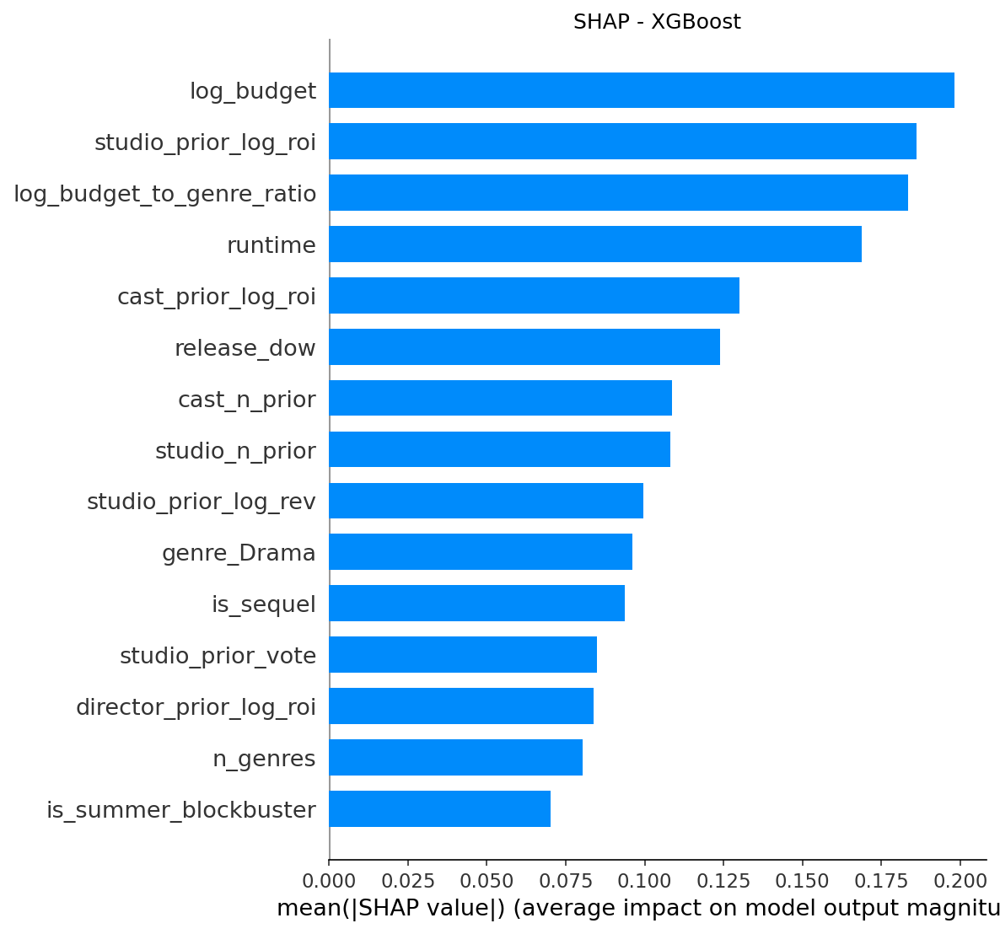
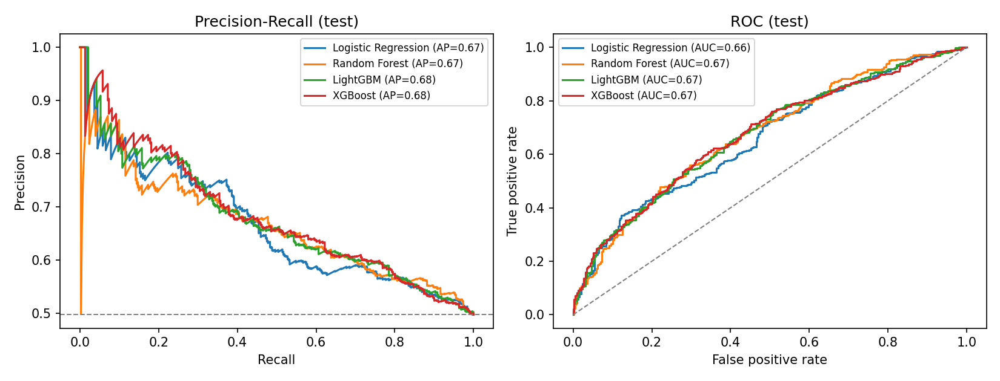

# Movie Commercial Success Prediction 🎬

Predicts whether a film will be commercially successful from information available **before release**
(budget, genre, cast/director/studio track record, release timing), and tests whether critic scores add
predictive value on top of that.

> **Headline result:** pre-release information gives a modest but real signal (test PR-AUC ≈ 0.67–0.68
> vs 0.50 for a random model). It is not a reliable greenlight oracle. See [Results](#results) and
> [Known limitations](#known-limitations).

## Repository structure

```
final_project_team/
├── README.md
├── requirements.txt
├── pytest.ini
├── .env.example
├── src/            # config, data_cleaning, tmdb_enrichment, scraper, review_scraper,
│                   # features, history_lagged, train_models, baselines, critic_study, app
├── scripts/        # setup_repo.sh
├── notebooks/      # final_project.ipynb
├── tests/          # pytest suite (leakage tests, scraper tests)
├── dev/            # make_sample_data.py (synthetic data for smoke tests)
├── data/           # not tracked: raw Kaggle CSVs + generated files
├── models/         # not tracked: deployment artifacts (.joblib)
└── reports/        # metrics tables and figures
```

## Pipeline

```
data/tmdb_5000_*.csv ─► data_cleaning ─► tmdb_enrichment ─► scraper + review_scraper ─► features ─► train_models ─► app
     (Kaggle)             parse, 0→NaN     TMDB API v3      OMDb       history +    4 models, CV +   Streamlit
                                                                       seasonality  temporal test
                                                                                         │
                                                                              baselines · critic_study
```

## Setup

```bash
git clone https://github.com/mohamednadercs1/final_project.git final_project_team
cd final_project_team
python3.11 -m venv .venv && source .venv/bin/activate      # Windows: .venv\Scripts\activate
pip install -r requirements.txt
cp .env.example .env                                       # then paste your keys (Windows: copy)
```

Python 3.11 is recommended.

1. Download the **TMDB 5000 Movie Dataset** from Kaggle into `data/`
   (`tmdb_5000_movies.csv`, `tmdb_5000_credits.csv`). The data is not included in this repository.
2. Free API keys: [TMDB](https://www.themoviedb.org/settings/api) (v3 key or v4 token) and
   [OMDb](https://www.omdbapi.com/apikey.aspx) (activate via the email link).

## Run

```bash
python src/data_cleaning.py          # -> data/movies_parsed.pkl
python src/tmdb_enrichment.py        # -> data/tmdb_enriched.csv   (~4,800 requests, cached/resumable)
python src/scraper.py --limit 900    # -> data/critic_scores.csv   (OMDb free tier = 1,000/day; re-run daily)
python src/review_scraper.py --contact you@example.com --limit 300 --merge
                                     # -> data/critic_scores_scraped.csv, gaps of critic_scores.csv filled
python src/features.py               # -> data/modeling_frame.pkl
python src/train_models.py           # ROI target; also: --target revenue | --target tier
python src/baselines.py              # ablations + lag sensitivity  -> reports/
python src/critic_study.py           # critic-score comparison      -> reports/
pytest -q                            # unit + leakage tests
streamlit run src/app.py
```

Notes:
- Always run `scraper.py` **before** `review_scraper.py --merge`, because `scraper.py` rewrites `critic_scores.csv`.
- After any change to the critic scores, re-run `features.py` and then `train_models.py`.
- Steps 2–3b are optional for a first run (you get a greenlight-only model from the Kaggle data).
- No keys at all? Smoke-test with synthetic data: `python dev/make_sample_data.py --n 2500 --extras`.

## Design decisions

- **Targets:** `success_roi` = revenue ≥ 2.5× budget (default), `success_rev` = revenue ≥ $100M,
  `tier` = Low (<1×) / Medium / High (≥2.5×). Revenue is never imputed.
- **Web scraping:** `review_scraper.py` reads Wikipedia film articles with `requests` + `BeautifulSoup`
  and extracts the Rotten Tomatoes (critics) percentage and the Metacritic score from the
  "Critical response" text. Rotten Tomatoes itself is not scraped because its terms of use forbid
  it. The scraper checks `robots.txt` for every URL, identifies itself with a descriptive
  User-Agent, waits ≥ 1 s between requests, backs off on 429/5xx, and is resumable.
  OMDb values take precedence when both sources have a score.
- **Look-ahead bias:** `popularity`, `vote_average`, `vote_count`, IMDb rating and RT *audience* score
  are measured after release and excluded from every model (enforced in `train_models.py` and covered
  by `tests/test_leakage.py`). Director/cast/studio history uses only earlier films. Critic scores
  (Tomatometer / Metascore) are fetched today, so the critic model is "post-screening", not strictly
  pre-release.
- **Greenlight gap:** films are greenlit 12–24 months before release, so `history_lagged.py` lets a
  film see only films released at least N days earlier (also removes same-day ties, which the
  original implementation leaked; documented as an `xfail` test).
- **Validation:** stratified 5-fold CV for model/threshold selection; the most recent 20% of films is a
  temporal test set never used for tuning. `baselines.py` adds an expanding-window (time-respecting) CV.
- **Thresholds:** the F1-optimal and cost-optimal decision thresholds are chosen on out-of-fold training
  predictions and then applied to the test set, so the test set is never used for tuning.
- **Metrics:** PR-AUC (primary, compare with the base rate), ROC-AUC, accuracy, balanced accuracy, F1,
  precision, recall, and a cost-benefit confusion matrix (`--cost-fp`, `--cost-fn`, in $M).
- **Explainability:** SHAP summary and bar plots and tree feature importance for the selected model
  (saved in `reports/`).
- **Deployed model:** the better of LightGBM / XGBoost by CV PR-AUC, refit on all films.

## Results

Greenlight model, target ROI ≥ 2.5×. Train: 3,063 films (1916–2011). Temporal test set: 766 films
(2011–2016), 50% successes (random PR-AUC = 0.50).

| Model | CV PR-AUC | Test PR-AUC | Test ROC-AUC | Accuracy | Balanced Acc | F1 | Precision | Recall |
|---|---|---|---|---|---|---|---|---|
| Logistic Regression | 0.659 | 0.666 | 0.659 | 0.591 | 0.592 | 0.656 | 0.564 | 0.782 |
| Random Forest | 0.655 | 0.666 | 0.673 | 0.601 | 0.601 | 0.661 | 0.572 | 0.782 |
| LightGBM | 0.656 | 0.677 | 0.673 | 0.591 | 0.593 | 0.669 | 0.560 | 0.832 |
| **XGBoost (deployed)** | 0.662 | 0.683 | 0.675 | 0.584 | 0.585 | 0.669 | 0.553 | 0.848 |

**Findings**
- Pre-release information gives modest but real predictive power (PR-AUC ≈ 0.67–0.68 vs 0.50 random).
- The four models are statistically close on 766 test films.
- Accuracy is 0.58–0.60 (vs about 0.50 for an always-predict-success baseline). The decision threshold
  maximises F1 on out-of-fold training predictions, which favours recall over accuracy.
- With a ~50% base rate, "predict success for every film" already reaches F1 ≈ 0.66, so F1 alone does
  not show skill here; PR-AUC and the cost analysis are the primary metrics.
- Performance on the newest films is at or below cross-validation, which points to drift over time.
- Business view (false positive = $25M, false negative = $10M): the models beat the best naive policy
  ("greenlight nothing", $3,810M) by $165M–$330M. Thresholds are chosen on out-of-fold training
  predictions, not on the test set, but the result still depends strongly on the assumed costs.
- Top SHAP features: `log_budget`, `studio_prior_log_roi`, `log_budget_to_genre_ratio`, `runtime`,
  `cast_prior_log_roi`.
- Critic scores help Logistic Regression (ΔPR-AUC +0.045, 95% CI [+0.019, +0.073]) but not significantly
  XGBoost (+0.022, CI [−0.014, +0.055]). Coverage (61% of films) is biased toward recent, bigger-budget
  films, and the critic model is post-screening, not pre-release.




### Robustness checks (`baselines.py`, `critic_study.py`)

| Question | Script | Result |
|---|---|---|
| How much comes from budget alone? | `baselines.py` | Little. Budget-only XGBoost PR-AUC 0.552 vs 0.683 full (Δ +0.131, CI [+0.087, +0.174]); close to the 0.497 random baseline. |
| Do director/cast/studio history features help? | `baselines.py` | They carry signal alone (history-only 0.619), but adding them to the other 64 features is not significant (Δ +0.014, CI includes 0). |
| Did the greenlight gap inflate the results? | `baselines.py` | No for XGBoost (Δ ≈ 0 at 365–730 day lags); slight inflation for Logistic Regression (≈ 0.01). |
| Do critic scores add value? | `critic_study.py` | Logistic Regression yes (+0.045); XGBoost not significant (+0.022, CI includes 0). Covered test films are larger-budget (median $35M vs $7.7M). |

Detailed tables are saved in `reports/` (`metrics_roi.csv`, `cost_benefit_roi.csv`, `ablation_roi.csv`,
`lag_sweep_roi.csv`, `critic_study_roi.csv`).

## Validating the scraper on the real site

The unit tests use hand-written HTML, so they check the parsing logic, not the live pages. After the
first real run, spot-check the output:

```bash
python src/review_scraper.py --contact you@example.com --limit 30
python - <<'PY'
import pandas as pd; d = pd.read_csv('data/critic_scores_scraped.csv')
print(d['status'].value_counts()); print(d.sample(10, random_state=0)[['title','year','wiki_title','rt_critic','metacritic']])
PY
```
Open 5–10 of the printed articles and confirm the numbers and that `wiki_title` is the right film
(a remake with the same title would be a wrong match). Report the match rate in your write-up.

## Tests

`pytest -q` runs the unit tests, the scraper tests (fake network, no internet needed) and the leakage
tests: one film's outcome is perturbed and the features of every film that must not know it are checked
for equality. Currently: 35 passed, 1 xfailed (the xfail documents the old same-day-ties leak).

## Known limitations

- Nominal (not inflation-adjusted) dollars; revenue is box office only.
- Films with missing budget/revenue are dropped, biasing toward well-documented releases.
- TMDB's current figures largely match the Kaggle snapshot, so API corrections fill only some zeros.
- Critic-score coverage is partial (61% of films); the critic comparison covers only films with a score.
- Wikipedia scores are the snapshot an editor typed in (usually near release), not every article quotes
  both scores, and coverage is biased toward well-known films. `critic_study.py` reports coverage and
  compares covered vs uncovered films.
- The test set is a few hundred films, so metric differences are noisy; read the bootstrap CIs.
- Predicted probabilities come from class-weighted models and are not calibrated.
- Cost-based savings depend strongly on the assumed costs (FP = $25M, FN = $10M).

## Data & credits

TMDB 5000 Movie Dataset (Kaggle) · TMDB API · OMDb API · critic scores extracted from Wikipedia
articles (text under CC BY-SA 4.0; only the numeric scores are stored). This product uses the TMDB API but is not
endorsed or certified by TMDB.
